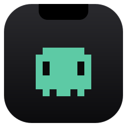
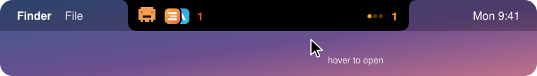
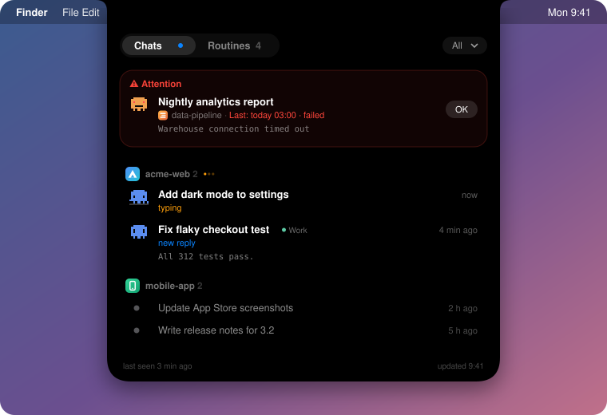

<p align="center">
  
</p>

<h1 align="center">Notchboard</h1>

<p align="center"><b>Claude Desktop sohbetlerin, rutinlerin ve profillerin, MacBook çentiğinde bir bakışta.</b></p>

<p align="center">
  <a href="https://github.com/yusufyesil/notchboard/releases/latest/download/Notchboard.dmg"></a>
</p>

<p align="center"><a href="../README.md">English</a> · Türkçe</p>

<p align="center">
  
</p>

<p align="center">
  
</p>

<p align="center"><sub><b>Üstüne gelince açılır:</b> sorunlar en üstte, gerisi projeye göre gruplu. Örnek verilerle çizim; arayüz İngilizce ve Türkçe.</sub></p>

MacBook çentiğinde duran küçük bir Claude Desktop kontrol paneli: zamanlanmış rutinler ve devam eden sohbetler.

## Hazır paketle kurulum

**[Notchboard.dmg](https://github.com/yusufyesil/notchboard/releases/latest/download/Notchboard.dmg)** dosyasını indir, aç ve **Notchboard**'u **Uygulamalar**'a sürükle. Paket henüz Apple noter onaylı değil; ilk açılışta macOS uygulamayı doğrulayamadığını söyler. **Bitti**'ye bas, **Sistem Ayarları › Gizlilik ve Güvenlik**'te aşağı inip Notchboard'un yanındaki **Yine de Aç**'a tıkla. Bu bir kez yapılır. Açılış penceresinde **Girişte başlat**'ı aç.

## Özellikler

- **Kapalı hali:** solda tek bir yıldız işareti: kırmızı (onaylanmamış sorun, yanında sayısı), turuncu ve dönen (çalışan bir şey var), mavi (son bakıştan beri yeni, yanında sayısı), soluk beyaz (her şey sakin). Sağda çalışan varsa turuncu üç nokta ve sayısı, yoksa bir sonraki rutine kalan süre.
- **Üstüne gelince:**
  - **Dikkat** (her zaman en üstte): başarısız ya da kaçırılmış rutinler ve senden yanıt bekleyen sohbetler. "Tamam" ile onaylanan kayıt buradan çıkar ve gri görünür; aynı rutin yeniden başarısız olursa tekrar düşer.
  - **Sohbetler / Rutinler sekmeleri:** ikisi de Desktop projesine (çalışma klasörüne) göre gruplu; worktree oturumları ana depo projesinin altında görünür. Sekmede yeni bir şey varsa mavi nokta çıkar.
  - **Sohbetlerde** önemli olan sonuç değil, yanıt: *yazıyor* (turuncu üç nokta), *yeni yanıt* (mavi, okunmamış), *senden yanıt bekliyor* (turuncu), *hata* (kırmızı), *okundu* (gri). Son yanıt, sohbeti Desktop'ta en son açtığın andan (`lastFocusedAt`) sonra geldiyse sohbet okunmamış sayılır. Okunmamış soru ya da hata Dikkat'e düşer. Satıra tıklamak sohbeti okundu yapar ve Claude'u açar. Okunmuş sohbetler tek satır görünür. Okunmamışlar en üstte; son 24 saat, okunmamışsa 7 gün gösterilir.
- **Claude Profiles:** `~/.claude-instances/<slug>` altındaki her profil kopyası da okunur ve tek listede birleşir. Aynı proje farklı profillerde olsa da tek grupta görünür; kopyaların satırlarında profilin Dock rengiyle küçük bir etiket var ("Ek 1"), ana profilin satırlarında etiket yok. Sağ üstteki profil menüsü (Tümü / Ana / Ek 1) listeyi tek profile daraltır. Satıra ya da bildirime tıklamak o profilin Claude'unu açar.
- **Sıralama:** çalışanlar en üstte, sonra okunmamışlar (rutinlerde son bakıştan beri bitenler), sonra en son hareket edenler (rutinlerde sıradaki çalışma). Proje grupları da en önemli satırlarına göre sıralanır. Bir sekmede çalışan bir şey varsa sekme adının yanında turuncu üç nokta görünür.
- **Proje logoları:** her proje grubunda logo var. Uygulama projenin klasöründe kendisi arar (adında `AppIcon` geçen dosya, kökteki `logo`/`icon`, favicon, `logo*` dosyaları; arşiv ve derleme klasörleri hariç), bulamazsa baş harfli renkli bir kare gösterir. Grup başlığına sağ tık: Logo seç…, Baş harfi kullan, Otomatik logoya dön, Klasörü Finder'da göster. Seçilen logolar `~/Library/Application Support/Notchboard/logos` içine kopyalanır. Logo Dikkat satırlarında, kapalı çentikte (ilgi isteyen projeler üst üste binmiş bir yığın olarak, en fazla 3 ve +N) ve macOS bildirimlerinde de görünür.
- **Mavi nokta:** son bakışından sonra biten iş. Liste en az bir saniye açık kaldıktan sonra kapandığında "son bakış" güncellenir.
- **Durum değişince:** bir rutin değiştiğinde ya da bir sohbete okunmamış yanıt geldiğinde liste 6 saniyeliğine kendiliğinden açılır.
- **Bildirim:** izin verilirse aynı olaylar macOS bildirimi olarak da gelir; bildirime tıklamak Claude'u açar.
- **İzinler ve ayarlar:** ilk açılışta, sonra sağ tık menüsünden. Claude verisinin okunup okunamadığını, bildirim iznini ve girişte başlatmayı gösterir.
- **Sağ tık:** Şimdi yenile, Claude'u aç, İzinler ve ayarlar…, Çık.

Çentik yoksa (harici monitör) menü çubuğunun ortasında aynı biçimde durur.

## Veri kaynağı

Ana Claude için `~/Library/Application Support/Claude`, her profil için `~/.claude-instances/<slug>` (aynı yapı). Profil adı `~/Applications` içindeki `local.claude-profiles.<slug>` paketinden, rengi Claude Profiles'ın kuralıyla (`.runtime/badges`, yoksa slug'ın `cksum % 6`) alınır.


- `~/Library/Application Support/Claude/claude-code-sessions/*/*/scheduled-tasks.json`: rutin listesi ve cron
- Aynı klasördeki `local_*.json`: her oturumun başlığı, son hareketi, hatası (`error`) ve özeti (`postTurnSummary`, `turnWrapUp`)

Bunlar Claude Desktop'ın iç dosyaları; bir güncellemede biçimleri değişirse uygulamanın da güncellenmesi gerekir. 15 saniyede bir okunur. Bir oturumun çalışıp çalışmadığı Claude Code dökümünün (`~/.claude/projects/*/<oturum>.jsonl`) son kaydından okunur: son mesaj turu bitiren bir yanıtsa bitmiştir; araç çağrısı, araç sonucu ya da senin mesajınsa çalışıyordur. 10 dakika sessiz kalan döküm durmuş sayılır. `Notchboard --states` o anki durumları, `Notchboard --find-icon <klasör>…` her proje klasörü için bulunacak logoyu yazdırır. Onaylar ve son bakış zamanı `UserDefaults` içinde tutulur.

## Dil

Arayüz İngilizce ve Türkçe. macOS dil sıranda Türkçe İngilizceden önce geliyorsa Türkçe açılır. Yalnız Notchboard'u Türkçe açmak için:

```bash
defaults write app.notchboard AppleLanguages -array tr
```

## Kaynaktan kurulum / güncelleme

```bash
./build.sh
```

Uygulamayı derler, durdurur, `~/Applications/Notchboard.app` içinde yerinde günceller ve yeniden başlatır. Girişte açılması için `~/Library/LaunchAgents/app.notchboard.plist` kullanılır; bu, İzinler ve ayarlar penceresindeki anahtarla da açılıp kapatılabilir.

Uygulama çalışırken paketi silmek, macOS'un "Uygulama Yönetimi" uyarısını tetikler. Uygulamanın böyle bir izne ihtiyacı yok, betik bu yüzden önce uygulamayı durduruyor.

Otomatik açılmayı tamamen kapatmak için:

```bash
launchctl bootout gui/$(id -u)/app.notchboard
```
